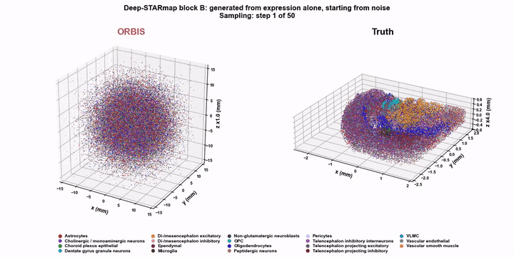

# ORBIS

ORBIS is a generative model for 3-D spatial reconstruction. From the gene expression of all cells of a specimen, it samples one
configuration of their 3-D positions, in physical units and in a frame shared by the specimens of a tissue, with no spatial reference
at inference. A flow-matching transformer is trained on spatially measured specimens, whatever form their measurement takes (serial
sections, thick blocks or whole embryos), and samples all cells of a new specimen jointly, up to millions, through one shared state.
A final reseating step swaps cells among the sampled positions, without moving them, so that each cell's neighbourhood matches its
expression.

## Demo

**Generation.** ORBIS generates a held-out Deep-STARmap block (198,675 cells) from gene expression alone: 50 sampling steps starting from noise, then reseating, next to the measured tissue. Colour = main cell class; depth is stretched for display, up to 4x.



**Comparison.** The measured block, ORBIS and LUNA-3D (our 3-D adaptation of LUNA, see `baselines/`), with the same camera and axes, each rigidly aligned to the truth (rotation, reflection, translation) with no rescaling; depth stretched 4x. Each zoom shows the same box in all three panels, at the densest 200 µm square of one cell class in the measured block. ORBIS: training seed 2 of `blockB`, 50-step sample and reseating.

PASTE_LINK_HERE

This repository holds the code, the configurations and the evaluation used for every number in the paper *Generative 3D Spatial
Reconstruction of Cellular Organization from Single-Cell Expression*.

## Contents

| folder | content |
|---|---|
| `orbis/model`, `orbis/data`, `orbis/train` | DiT backbone, training-view generator, training |
| `orbis/sample` | sampler (one shared state over all cells), chunk and fixed-window samplers (ablations), embryo unfold |
| `orbis/reseat` | niche reader, CPU and CUDA reseating engines |
| `orbis/metrics` | evaluation metrics, rulers, size-matched errors |
| `scripts/` | data preparation, train / sample / reseat / score entry points, ablation helpers, table builders, the dissociated-cell application |
| `configs/finals` | one config per final model and training seed |
| `configs/readers` | one config per niche reader |
| `configs/ablations`, `configs/robustness` | training ablations; sampler and input-robustness experiments |
| `configs/allen10x` | the dissociated-cell application |
| `baselines/` | our 3-D adaptations of the five published methods we compare with (index: `baselines/README.md`), as patches and scripts against each official repository, with their configs in `baselines/configs/` |

## Install

Three environments were used. Their exact versions are in `envs/`:

```bash
# training and sampling (python 3.11)
python -m venv orbis-train && source orbis-train/bin/activate && pip install -r envs/requirements-train.txt
# evaluation, reseating, readers, data preparation (python 3.9; reseating compiles CUDA kernels with nvcc 11.8 and g++-11)
conda env create -f envs/environment.yml
# mapping of dissociated 10x cells (python 3.11)
python -m venv orbis-symphony && source orbis-symphony/bin/activate && pip install -r envs/requirements-symphony.txt
```

Run every command from the repository root. Every script takes its inputs from `DATA_DIR` and writes to `OUT_DIR`.

## Data

Download the raw files into `$DATA_DIR/raw/<dataset>/`, then run the preparation script. Each script's header lists the exact files it
needs. The output layout under `$DATA_DIR` is the one the configs expect.

| dataset | source | preparation |
|---|---|---|
| MERFISH mouse brains 1-4 of the Allen Brain Cell (ABC) atlas (Zhang et al., Nature 2023, https://doi.org/10.1038/s41586-023-06808-9) | ABC atlas, https://allen-brain-cell-atlas.s3.us-west-2.amazonaws.com/ (release 20241115 manifest, https://allen-brain-cell-atlas.s3.us-west-2.amazonaws.com/releases/20241115/manifest.json): `expression_matrices/Zhuang-ABCA-<N>/20230830/Zhuang-ABCA-<N>-raw.h5ad`, `metadata/Zhuang-ABCA-<N>-CCF/20230830/ccf_coordinates.csv`, the cell metadata of each brain | `bash scripts/data/prepare_abc_mice.sh` |
| Allen MERFISH brain C57BL6J-638850 (Yao et al., Nature 2023, https://doi.org/10.1038/s41586-023-06812-z), integrated with the four brains above by Harmony | ABC atlas: `expression_matrices/MERFISH-C57BL6J-638850/20230830/C57BL6J-638850-raw.h5ad` and the 638850 cell metadata and CCF coordinates | `bash scripts/data/prepare_allen_merfish.sh` (after the mice) |
| Deep-STARmap brain blocks (Sui et al., Nature Methods 2025, https://doi.org/10.1038/s41592-025-02867-0) | Zenodo, https://doi.org/10.5281/zenodo.16783355 | `bash scripts/data/prepare_deep_starmap.sh` |
| Flysta3D-v2 Drosophila embryos, Stereo-seq (Cell 2025, https://doi.org/10.1016/j.cell.2025.05.047) | STOmics DB STDS0000398, https://db.cngb.org/stomics/flysta3d-v2/ (files: https://ftp.cngb.org/pub/SciRAID/stomics/STDS0000398/) | `bash scripts/data/prepare_flysta3d.sh` |
| Allen whole-brain 10x v3 single cells (Yao et al., Nature 2023, https://doi.org/10.1038/s41586-023-06812-z) | ABC atlas release 20231215 (manifest https://allen-brain-cell-atlas.s3.us-west-2.amazonaws.com/releases/20231215/manifest.json), `WMB-10Xv3` files | `bash scripts/data/allen10x/prepare_10x.sh` (see below) |

All commands are run as `DATA_DIR=/path/to/data bash <script>`. The ABC-atlas files must be saved under the names the script headers
give, and the script headers also give the per-file md5 sums of the public files where the source provides them. One mouse-3
annotation file, `Zhuang-ABCA-3_cell_metadata_with_cluster_annotation.csv`, is derived by `prepare_abc_mice` and written to
`$DATA_DIR/brains/annotation/`. It is not the file of the same name that the ABC atlas now distributes.

## Trained models and niche readers

The paper's trained models and fitted niche readers are on Zenodo: https://doi.org/10.5281/zenodo.23925991

| file | size | content |
|---|---|---|
| `orbis_models.tar` | 1.8 GB | the 22 final models: `models/<config>/orbis_epoch359.pt` for `mouse1`, `mouse2`, `mouse3`, `allen`, `blockA`, `blockB` (each with seeds `s0`, `s1`, `s2`) and `allen10x`; `models/embryo_s<seed>/orbis_epoch299.pt` for the embryos |
| `orbis_readers.tar` | 3.8 GB | the 8 niche readers used by the reseating step: `readers/reader_<model>_<test>.npz` |

```bash
export OUT_DIR=/path/to/outputs
wget https://zenodo.org/records/23925991/files/orbis_models.tar
wget https://zenodo.org/records/23925991/files/orbis_readers.tar
tar -xf orbis_models.tar -C $OUT_DIR
tar -xf orbis_readers.tar -C $OUT_DIR
(cd $OUT_DIR && md5sum -c models/MD5SUMS.txt readers/MD5SUMS.txt)
```

Each config then finds its model and reader in `$OUT_DIR` with no further setting.

The paper's reseated layouts reproduce exactly with these readers; `READER_MD5=<md5>` checks a reader before use (the md5 is given in
each config). A refit with `scripts/build_reader.sh` uses the same settings, but its k-means initialisation sums thread-partial results
in arrival order, so the refit can differ from the published reader in the last digits.

## Train, sample, reseat, evaluate

Every final model has one config, `configs/finals/<model>_s<seed>.sh`. The models are `mouse1`, `mouse2`, `mouse3`, `allen`, `blockA`, `blockB`
and `embryo`, each with three training seeds `s0`, `s1` and `s2`; `allen10x` is the dissociated-cell model. Each config names its test
set; the embryo configs take `EMBRYO=c` or `EMBRYO=d`.

```bash
export DATA_DIR=/path/to/data OUT_DIR=/path/to/outputs
C=configs/finals/mouse2_s0.sh

# 1. train (NPROC = GPUs; the effective batch is fixed by the config, so the result does not depend on NPROC)
bash scripts/train.sh $C

# 2. sample: four 50-step draws and their one-call guesses (sampler seeds 1000-1003)
for S in 1000 1001 1002 1003; do
  MODE=draw  SEED=$S bash scripts/sample.sh $C
  MODE=guess SEED=$S bash scripts/sample.sh $C
done

# 3. reseat (fit the test set's niche reader once, on CPU)
bash scripts/build_reader.sh configs/readers/mouse2.sh
bash scripts/reseat.sh $C

# 4. evaluate the raw and the reseated draws
bash scripts/score.sh $C
```

To use the trained models and readers from Zenodo (see *Trained models and niche readers* above), start at step 2 and leave out
the reader fit in step 3. A checkpoint stored elsewhere is passed as `CKPT=/path/to/orbis_epoch359.pt`.

Outputs go to `$OUT_DIR/models`, `samples`, `readers`, `reseated` and `scores`.

Scores are reproducible bit for bit with the thread counts in the configs and scripts. A few floating-point reductions in scoring
depend on the number of threads.

## Reproduce the paper's tables

The table builders read a results registry: one JSON file that lists, per test, the score files of every training's draws, the
baselines' score files and the ablation runs. Its format is documented in `scripts/tables/registry.py`.

```bash
python scripts/tables/build_main_tables.py registry.json tables/       # main table + supplement tables (per test, per training, controls, one-call, sampling)
python scripts/tables/build_ablation_tables.py registry.json tables/   # ablation and robustness tables
```

The main table uses the 21 finals `configs/finals/{mouse1,mouse2,mouse3,allen,blockA,blockB,embryo}_s{0,1,2}.sh`: four draws each,
reseated, plus the one-call guesses for the supplement.

## Ablations and robustness

- **Training ablations.** One config per arm in `configs/ablations/`: the arm's final config with only the ablated flags changed. Run
  them like the finals. Two arms need extra steps:
  - The A1 arms sample with the chunk sampler.
  - The A2 arms sample with fixed independent windows. Their output is mapped back to the specimen frame by
    `scripts/ablations/protocol_r.py`, using the unit-box scales from `scripts/ablations/unit_box_scale.py`.
- **Sampler and input-robustness experiments.** Configs in `configs/robustness/`. Each one reuses the seed-0 final of
  `MODEL=<model>`; nothing is retrained.
  - Perturbed test copies come from `scripts/ablations/perturb.py`.
  - Fewer-cells subsets come from `scripts/ablations/make_subsets.py`; their references from `scripts/ablations/restrict_layout.py`.

```bash
MODEL=mouse2 STEPS=10 SEED=1000 bash scripts/sample.sh configs/robustness/S1_sampling_steps.sh
```

## Dissociated cells (Allen 10x v3)

The 10x application uses the Allen whole-brain single-cell atlas: ABC atlas release 20231215, manifest
https://allen-brain-cell-atlas.s3.us-west-2.amazonaws.com/releases/20231215/manifest.json.

Files needed:
- the 13 WMB-10Xv3 `*-raw.h5ad` files under `expression_matrices/WMB-10Xv3/20230630/` (URLs, sizes and md5 sums are read from the manifest);
- the metadata `metadata/WMB-10X/20231215/{cell_metadata.csv,gene.csv}` and
  `metadata/WMB-taxonomy/20231215/views/cluster_to_cluster_annotation_membership_pivoted.csv`;
- the Allen CCF parcellation table:
  https://allen-brain-cell-atlas.s3.us-west-2.amazonaws.com/metadata/Allen-CCF-2020/20230630/views/parcellation_to_parcellation_term_membership_acronym.csv;
- the CCFv3 2017 annotation:
  https://download.alleninstitute.org/informatics-archive/current-release/mouse_ccf/annotation/ccf_2017/annotation_25.nrrd;
- the structure graph: https://api.brain-map.org/api/v2/structure_graph_download/1.json.

The MERFISH brains and their raw tables are the ones prepared for the brain experiments (`$DATA_DIR/brains`, `$DATA_DIR/raw/abc_mice`,
`$DATA_DIR/raw/allen_merfish`). Four small curated inputs ship in `scripts/allen10x/inputs/`. Run, in order:

1. `MANIFEST=<manifest.json> bash scripts/data/allen10x/prepare_10x.sh` downloads, extracts and merges the 10x v3 pool. It then builds
   the Symphony reference on the five MERFISH brains, maps the pool and builds the five training stores, all under
   `$DATA_DIR/allen10x/`.
2. `bash scripts/train.sh configs/finals/allen10x.sh` trains the model (seed 0).
3. `CKPT=<checkpoint> bash scripts/allen10x/run_application.sh` runs the full application: fixed inputs, cohorts, sampling (GPU),
   label-free pose readout, evaluation, summaries, official-annotation scorer and gene maps.

## Baselines

`baselines/README.md` lists the five methods. `baselines/<name>/README.md` gives, for each method:
- the official repository and the exact commit;
- what our 3-D adaptation changes and why;
- the patch, or none if the method ran unmodified;
- the driver scripts.

`baselines/configs/<name>_<test>.sh` holds the settings of every run behind a number in the paper, including the dissociated-cell
comparison.
